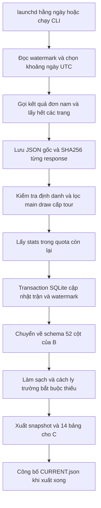

# Thu thập tennis định kỳ bằng RapidAPI

**Cập nhật luồng tuần:** cấu hình được nghiệm thu gần nhất dùng job thứ Hai 07:40 chạy `run_unified_load.py --collect --refresh-reference` để đối soát API và incremental load vào schema chung. Lịch lấy raw hằng ngày không đổi. B/C đọc `runs/unified/CURRENT.json`; xem [schema chung](unified_schema.md) thay vì tự nối hai CSV nguồn. Đây là trạng thái cài đặt được ghi nhận trên macOS ngày 29/10/2026; chưa xác minh lịch còn hoạt động trên máy Windows hiện tại.

Phiên bản mới bổ sung replay/resume từ raw, log theo operation và cảnh báo Telegram qua tin nhắn riêng từ bot tới cá nhân bạn. Đọc [hướng dẫn phục hồi và theo dõi](recovery_and_alerts.md). Lịch setup hiện tạo 3 job, gồm thêm flush outbox mỗi 10 phút; các mô tả hai lịch thu thập bên dưới vẫn áp dụng.

Luồng API được triển khai bổ sung cho phần A và dùng lại module làm sạch, tạo đặc trưng, thống kê của B. Dữ liệu lịch sử 2015–2025 và báo cáo hiện có được giữ riêng. API lưu vào SQLite, không sửa CSV nguồn lịch sử và không tự nối ID của hai nhà cung cấp.

Trạng thái mới nhất ngày 29 tháng 10 năm 2026: đã xác thực API thật, thu thập 70 trận đúng phạm vi trong ngày 2026-10-22 đến 2026-10-28, lưu raw/SQLite và xuất 14 bảng B. Ba lịch launchd đã được cài; chi tiết kiểm tra vận hành ở reports/live_activation.md. Demo vẫn là dữ liệu nhân tạo lưu riêng.

Response thật của nhà cung cấp để trống best_of. Adapter hiện bổ sung từ quy định giải đã kiểm chứng trong config/tennis_format_rules.json, chỉ cho main draw đơn nam năm 2026: cấp tour/Masters/Finals là 3, Grand Slam là 5. Không suy từ số set đã chơi, không thay giá trị API đã cung cấp. provenance.csv ghi best_of_source và best_of_reference. Năm/loại giải ngoài phạm vi quy tắc vẫn để thiếu và bị cách ly; cần rà soát quy định khi sang năm mới.

## Đăng ký và cấu hình key

1. Mở https://rapidapi.com/jjrm365-kIFr3Nx_odV/api/tennis-api-atp-wta-itf và chọn gói FREE nếu gói này vẫn được cung cấp khi đăng ký. Kiểm tra quota và điều kiện hiển thị trên tài khoản của bạn trước khi xác nhận.
2. Lấy X-RapidAPI-Key trong trang endpoint. Chỉ có key RapidAPI mà chưa đăng ký sản phẩm có thể vẫn nhận HTTP 403.
3. Mở `.env` ở thư mục KHDL. File đã được tạo với quyền chỉ chủ sở hữu đọc/ghi và đang để trống key. Điền trực tiếp trên máy:

```dotenv
RAPIDAPI_KEY=your_actual_key_here
```

Không thêm backtick hay dấu ngoặc nhọn. Không gửi key vào chat hoặc commit Git. `.env` và dữ liệu API đều đã được thêm vào gitignore. File `.env.example` có thể chia sẻ vì chỉ chứa tên biến và hướng dẫn. Biến môi trường RAPIDAPI_KEY đã có giá trị sẽ được ưu tiên hơn file .env.

Chạy tại thư mục dự án:

```bash
# Chỉ kiểm tra cấu hình và key có mặt, không gọi mạng hay xác minh key hợp lệ
.venv/bin/python scripts/run_api_batch.py --check

# Thử lấy một ngày trước để kiểm chứng key, endpoint và response thật
.venv/bin/python scripts/run_api_batch.py --start 2026-10-28 --end 2026-10-28

# Sau khi thử thành công, lấy lại đủ 7 ngày gần nhất lần đầu
.venv/bin/python scripts/run_api_batch.py --start 2026-10-22 --end 2026-10-28

# Các lần chạy bình thường tự chọn cửa sổ theo ngày UTC hiện tại
.venv/bin/python scripts/run_api_batch.py
```

Hai khoảng ngày cụ thể trên dùng cho ngày thiết lập 29 tháng 10 năm 2026. Nếu thực hiện vào ngày khác, thay bằng các ngày đã kết thúc theo UTC. Không cần tải 11 mùa lịch sử qua API miễn phí; dữ liệu nền đã có.

## Luồng dữ liệu



## Những gì được lấy từ API

Nhà cung cấp: Tennis API – ATP WTA ITF trên RapidAPI. Host duy nhất được phép nhận key: `tennis-api-atp-wta-itf.p.rapidapi.com`. Hai endpoint sử dụng:

```text
GET /tennis/v2/atp/results/{startDate}/{endDate}
    filter=PlayerGroup:singles&pageSize=500&pageNo=1

GET /tennis/v2/matches/{stableCompositeId}/stats
    type=atp&source=game
```

Tài liệu xác nhận atp bao gồm nhiều cấp độ nam, không chỉ ATP Tour. Vì vậy code lọc lại rankId 2 3 4 7, loại vòng qualifying 0–3 và các tên giải đồng đội, Olympic, Next Gen. Mọi trang đều phải trả data array và hasNextPage boolean. HTTP 200 với data rỗng và hasNextPage=false là ngày không có kết quả hợp lệ; thiếu envelope không được xem là không có trận.

## Định danh và cập nhật không trùng

Tài liệu nhà cung cấp ghi rõ id/matchId dạng số của kết quả có thể bị đánh lại và tái sử dụng. Code chỉ lưu số đó làm archive_id để truy vết, không dùng làm khóa database. Khóa chính gồm provider và stable_key:

```text
stable_key = min(player1Id,player2Id)-max(player1Id,player2Id)-tournamentId-roundId
```

tournamentId là ID phiên bản giải, không chỉ tên giải. Thứ tự ID được chuẩn hóa để sửa người thắng không tạo trận thứ hai. Stats được ghép theo ID thực trong player1Stats/player2Stats, không theo vị trí. Nếu API đổi người tham gia, ID giải hoặc vòng, sẽ thành khóa khác; hiện chưa có feed xóa/merge của nhà cung cấp được tích hợp. Không tự xóa trận chỉ vì nó vắng ở một lần đọc. Đây là giới hạn cần đối soát khi vận hành.

Hash nội dung bỏ qua id/matchId dạng số để việc đánh lại archive_id không bị tính như thay đổi kết quả. Khi nội dung kết quả thay đổi, stats cũ không được mang sang nếu chưa làm mới. Bản gốc từng lần gọi vẫn còn trong raw để kiểm tra.

## SQLite và nhật ký

Database thật ở `data/api/tennis.sqlite3` với các bảng:

| Bảng | Chức năng |
| --- | --- |
| matches | Trận mới nhất theo khóa ổn định, JSON kết quả/stats, thời điểm thấy và nguồn |
| batch_runs | Khoảng ngày, trạng thái collecting/succeeded/failed và số lượng của từng batch |
| requests | Mỗi lần thử HTTP, kể cả retry, có ngày UTC, endpoint, status, raw path, SHA256 |
| sync_state | Ngày cuối thu thập thành công liên tục kể từ mốc khởi tạo |
| rejected_records | Bản ghi có lỗi cấu trúc hoặc định danh, giữ để kiểm tra |

Tất cả trang kết quả phải được thu thập xong trước khi cập nhật bảng matches. Trận và watermark commit cùng transaction. Nếu API lỗi, phân trang thiếu, JSON sai hoặc định danh không khớp thì batch thất bại, không thay đổi matches/watermark; raw và log request vẫn được giữ. Backfill có khoảng trống không tự nhảy watermark qua ngày chưa lấy.

Khóa file ngăn hai batch/export CLI chạy chồng lên nhau. Export là bước sau transaction: nếu export lỗi, database đã thu thập thành công vẫn an toàn, CURRENT cũ vẫn dùng được; chạy `--export-only` để khôi phục báo cáo mà không tốn API call.

## Quota miễn phí và độ đầy đủ stats

Theo tài liệu kiểm tra ngày triển khai, FREE có 50 request/ngày và 4 request/giây. Cấu hình mặc định chủ động giới hạn 40 request/ngày UTC trên máy này, nghỉ tối thiểu 0,35 giây giữa request, tối đa 2 retry cho lỗi mạng hoặc 500/502/503/504. Mỗi retry đều được ghi và tính vào ngân sách. Không tự nâng gói hoặc gọi endpoint dự đoán trả phí.

HTTP 401/403/404 và 429 dừng batch; không diễn giải thành dữ liệu rỗng. Quota cục bộ không biết request từ máy hoặc ứng dụng khác dùng chung key; ngày reset của nhà cung cấp cũng có thể khác ngày UTC cục bộ. Vì vậy phản hồi 429 vẫn là giới hạn cuối cùng và cần đợi nhà cung cấp reset trước khi thử tiếp.

Ưu tiên lấy hết kết quả trước. Sau đó lấy tối đa 20 stats mỗi lần, ưu tiên trận chưa kiểm tra hoặc kiểm tra lâu nhất. Stats đã có được làm mới sau 7 ngày; stats rỗng được thử lại sau 1 ngày. Một lần chạy có thể không đủ quota lấy stats mọi trận; timestamp và nguồn từng trận ở provenance.csv cho biết độ phủ. Kết quả vẫn có thể được cập nhật khi chưa đến lượt làm giàu stats.

Mặc định đọc lại 7 ngày đã kết thúc theo UTC. Nếu job nghỉ lâu hơn, dùng watermark để bắt đầu từ ngày chưa lấy, tránh bỏ trống dữ liệu. Job đối soát tuần dùng 30 ngày. Nếu backlog quá lớn so quota, chia nhỏ khoảng ngày bằng --start/--end; chỉ các khoảng liên tục mới kéo watermark tiến lên.

## Chuyển sang dữ liệu của B

Adapter chỉ dùng các trường đã được mô tả rõ trong tài liệu:

| Nguồn API | Đích B |
| --- | --- |
| player1/player2 trên endpoint results | winner/loser; xác nhận match_winner nếu có |
| tournament.date hoặc startDate | tourney_date và năm bắt đầu giải |
| tournament.rankId | A M G F |
| courtId 1 hoặc 3 | Hard, giữ provenance trong JSON nguồn |
| courtId 2 hoặc 5 | Clay hoặc Grass |
| result_type | Bổ sung RET/W/O/DEF để B không nhầm trận hoàn tất |
| aces, doubleFaults | w/l_ace, w/l_df |
| firstServeOf, firstServe | w/l_svpt, w/l_1stIn |
| winningOnFirstServe, winningOnSecondServe | w/l_1stWon, w/l_2ndWon |
| breakPointSavedGm, breakPointFacedGm | w/l_bpSaved, w/l_bpFaced |

API match date UTC được giữ trong provenance.csv, không gán vào cột ngày bắt đầu giải. season của snapshot API hiện dùng năm bắt đầu giải do chưa có trường mùa chính thức được xác minh; dữ liệu này được phân tích riêng, không gộp xu hướng mùa với Sackmann. Nếu ngày bắt đầu giải thiếu, B cách ly dòng. best_of thiếu chỉ được bổ sung khi khớp quy tắc có nguồn và năm đã kiểm chứng; ngoài phạm vi đó vẫn bị cách ly. Rank trước giải, tuổi, chiều cao, minutes và service-game totals hiện để thiếu vì hai endpoint đang dùng chưa cung cấp trường đã xác minh cho chúng. Vì vậy snapshot API hiện chưa tính được upset hoặc thời lượng có mẫu số hợp lệ. Stats giao bóng và số trận vẫn tính được khi có dữ liệu.

## Đọc đầu ra mới nhất

File `runs/api/CURRENT.json` chỉ tới thư mục snapshot hoàn chỉnh. Dùng đường dẫn này thay vì hardcode tên snapshot:

```python
import json
from pathlib import Path
import pandas as pd

output = Path('runs/api')
pointer = json.loads((output/'CURRENT.json').read_text())
snapshot = output/pointer['snapshot']
matches = pd.read_csv(snapshot/'tennis_matches.csv')
trend = pd.read_csv(snapshot/'tables/season_summary.csv')
```

Snapshot có canonical_input.csv, tennis_matches.csv, player_matches.csv, provenance.csv, quarantine.csv, validation_issues.csv, cleaning_actions.csv, excluded_scope.csv, duplicates.csv và tables/. export_manifest.json ghi quần thể, hạn chế và hash. Khi chưa có trận đủ schema, n_tables=0 và không tạo bảng EDA giả; xem quarantine trước.

```bash
# Xuất lại từ SQLite, không gọi API và không cần key
.venv/bin/python scripts/run_api_batch.py --export-only

# Chạy thử toàn luồng bằng fixture nhân tạo, không cần key/mạng
.venv/bin/python scripts/run_api_batch.py --demo

# Chạy lại demo phải không nhân đôi dữ liệu
.venv/bin/python scripts/run_api_batch.py --demo
```

Demo chỉ ghi `runs/api_demo/`, có mode=demo trong manifest và không có đường nhập vào database thật. Không dùng số liệu demo làm kết luận đồ án.

## Lịch chạy trên máy Mac này

Đã cài ba job launchd, gồm hai job dữ liệu và một job flush Telegram mỗi 10 phút. Xem reports/live_activation.md cho trạng thái nghiệm thu. Giờ chạy theo timezone của máy: hằng ngày 07:10, thứ Hai 07:40 cho đối soát 30 ngày. Đặt timezone máy là Asia/Ho_Chi_Minh để đúng giờ Việt Nam. Request vẫn dùng ngày UTC để tránh lệch ngày giữa các giải.

Sau khi chạy batch thật thành công:

```bash
# Xem/tạo lại plist, chưa bật lịch
.venv/bin/python scripts/setup_api_schedule.py

# Bật lịch; script kiểm tra key có mặt trước khi cài
.venv/bin/python scripts/setup_api_schedule.py --install

# Tắt lịch, giữ dữ liệu
.venv/bin/python scripts/setup_api_schedule.py --uninstall
```

Log ở logs/vn.khdl.tennis.daily.log và file .error.log tương ứng. Đây là lịch local: máy tắt hoặc tài khoản chưa có session thì không bảo đảm chạy đúng giờ. Khi máy hoạt động lại, watermark giúp lấy bù. Muốn chạy liên tục độc lập máy cá nhân có thể chuyển cùng CLI lên server; chưa triển khai hạ tầng bên ngoài trong phiên bản này.

## Tài liệu nhà cung cấp và điều kiện sử dụng

- https://docs.tennis-api.com/getting-started
- https://docs.tennis-api.com/results
- https://docs.tennis-api.com/schema

Điều khoản dữ liệu API theo nhà cung cấp/gói đăng ký, không tự động kế thừa giấy phép CC BY-NC-SA của bộ Sackmann. Quyền gọi API không mặc định là quyền công khai toàn bộ JSON; kiểm tra điều kiện trước khi chia sẻ dữ liệu thật ra ngoài. Mã pipeline có thể chia sẻ không kèm key và dữ liệu riêng của tài khoản.
