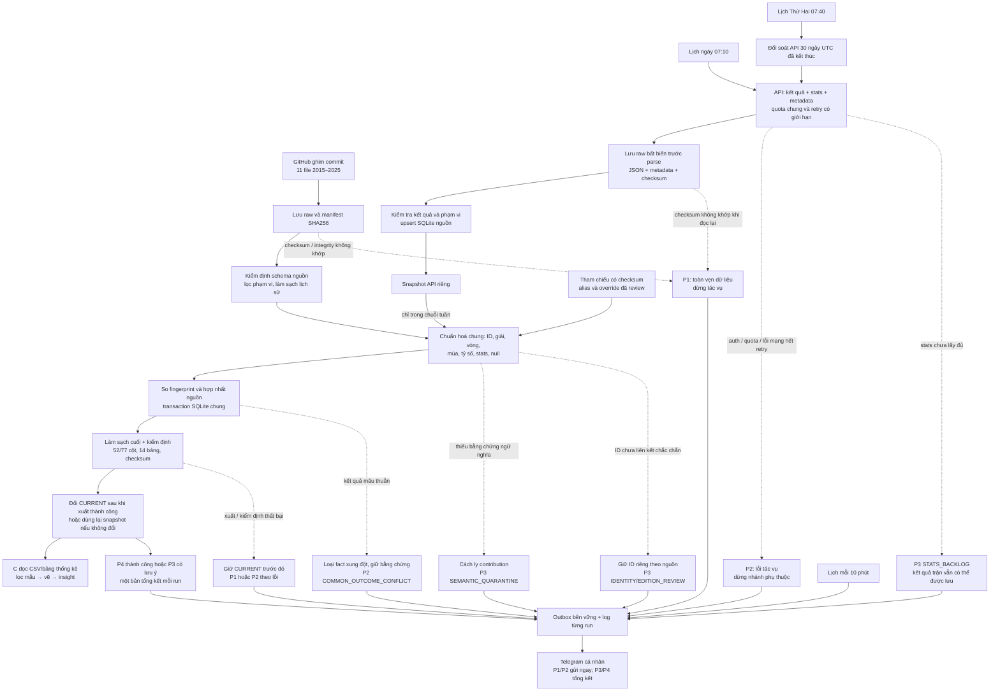

# Tài liệu dữ liệu và pipeline phục vụ trực quan hoá tennis

Phiên bản tài liệu: 1.0 — ngày 29/10/2026. Tài liệu mô tả hệ thống đang triển khai, không phải thiết kế dự kiến. Số liệu dưới đây là ảnh chụp nghiệm thu tại ngày này; các lần đồng bộ sau có thể làm thay đổi số dòng.

## 1. Mục đích và phạm vi

Đây là tài liệu bàn giao từ phần A (thu thập, chất lượng) và B (tiền xử lý, thống kê) sang phần C (trực quan hoá, insight, báo cáo), theo kế hoạch phân công của nhóm.

Dữ liệu hiện đủ để trực quan hoá mô tả về cơ cấu giải/mặt sân, thời lượng, giao bóng, thứ hạng, kết quả và chất lượng dữ liệu. Phạm vi là **đơn nam cấp tour**, gồm ATP tour thông thường (A), Masters (M), Grand Slam (G), ATP Finals (F); loại giải đồng đội, Olympic, Next Gen, vòng loại và các cấp ngoài phạm vi. Không suy rộng kết quả sang WTA hoặc toàn bộ tennis chuyên nghiệp.

| Lớp dữ liệu | Trạng thái tại nghiệm thu |
| --- | --- |
| GitHub raw | 11 file, 30.616 dòng, mùa 2015–2025 |
| GitHub sau lọc/làm sạch | 27.574 trận |
| API đã lưu và chuẩn hoá chung | 70 trận, ngày thực tế 22–28/10/2026 |
| Bộ chung | **27.644 trận**, 52 cột đầu vào chuẩn, 77 cột sau xử lý |
| Bảng phân tích | 14 bảng CSV, có hợp đồng cột |
| Kiểm chứng | 143 tests đạt; nạp lại: 0 thêm, 0 cập nhật, 27.644 không đổi |

**Lưu ý độ phủ:** 70 trận API hiện đều trên Hard, thiếu rank và minutes; chỉ 20 trận có ace ở cả hai phía. Năm 2026 chưa đủ mùa, còn khoảng trống từ đầu năm đến 21/10. Các biểu đồ lịch sử chính nên lọc 2015–2025; dữ liệu mới 2026 hiển thị ở khu vực riêng và ghi rõ khoảng ngày.

## 2. Dữ liệu lấy từ đâu?

### 2.1. Nguồn lịch sử GitHub

- Tác giả dữ liệu: **Jeff Sackmann / Tennis Abstract**; kho gốc: https://github.com/JeffSackmann/tennis_atp.
- Bản lưu trữ được dùng khi triển khai: https://github.com/Aneeshers/tennis-sackmann-archive.
- Commit được ghim: `83733587353df8a41f2fd4f516147d5aa83f5a8d`, đường dẫn `atp/atp_matches_<năm>.csv`.
- Raw tại `data/raw/`; URL từng file, số dòng và SHA256 trong `data/provenance/source_manifest.json`.
- Dữ liệu tham chiếu người chơi `atp_players.csv` lấy từ cùng commit, lưu tại `data/reference/github_players.csv`, có manifest riêng.
- Giấy phép được ghi nhận: **CC BY-NC-SA 4.0**; khi sử dụng cần giữ ghi công và điều kiện tương ứng. Bản sao giấy phép ở `data/provenance/LICENSE`.

Đây là nền dữ liệu lịch sử cố định theo commit đã ghim, không tự chạy theo nhánh mới nhất của GitHub. Ghim phiên bản giúp tái tạo kết quả.

### 2.2. Nguồn cập nhật API

- Dịch vụ: **Tennis API – ATP WTA ITF** qua RapidAPI; host cấu hình `tennis-api-atp-wta-itf.p.rapidapi.com`, pipeline hiện chọn ATP.
- Tài liệu nhà cung cấp: https://docs.tennis-api.com/.
- Thu thập kết quả trận, bổ sung thống kê chi tiết và metadata nhánh đấu khi cần. Không phải trận nào cũng có đủ thống kê.
- Response nguyên bản và metadata request lưu tại `data/api/raw/<run_id>/`; metadata chứa thông tin phục hồi và checksum, không chứa credential.
- SQLite nguồn ở `data/api/tennis.sqlite3`: trận, batch, audit request, cache và trạng thái đồng bộ.
- API key đọc từ `.env`; không đưa vào notebook, biểu đồ, báo cáo hoặc gói dữ liệu công khai.

Quyền sử dụng dữ liệu API theo nhà cung cấp; không tự gán giấy phép GitHub cho dữ liệu API. Quota **40 request/ngày UTC** là giới hạn bảo vệ do dự án đặt trong `config/api_batch.json`, không phải cam kết về gói dịch vụ. Retry và request tham chiếu cũng dùng chung quota này.

## 3. Các lớp lưu trữ và điểm đọc cho phần C

| Vị trí | Vai trò | Có dùng trực tiếp để vẽ không? |
| --- | --- | --- |
| `data/raw/` | Raw GitHub cố định | Không ưu tiên; chưa lọc/làm sạch |
| `data/api/raw/` | Raw JSON API + metadata, phục hồi không gọi lại API | Không; cần adapter và kiểm định |
| `data/interim/` | Kết quả làm sạch nhánh GitHub: excluded, duplicate, quarantine, issues | Dùng cho biểu đồ chất lượng của nhánh này |
| `data/processed/` | CSV đã xử lý **chỉ nhánh GitHub** | Có, cho lịch sử 2015–2025 |
| `data/reference/`, `data/mappings/` | Tham chiếu tự động và override có lý do | Dùng để đối chiếu định danh |
| `data/unified/tennis.sqlite3` | Kho chung, contributions, crosswalk, xung đột, lịch sử load | Có qua SQL trích JSON; chưa có view phẳng chuyên cho BI |
| `runs/unified/CURRENT.json` | Con trỏ tới snapshot chung được công bố | **Điểm bắt đầu khuyến nghị cho C** |
| `runs/unified/<snapshot>/` | CSV phẳng, 14 bảng, coverage, provenance, manifest | **Đầu vào trực quan hoá chính** |
| `data/monitoring/alerts.sqlite3` | Hàng đợi và lịch sử gửi Telegram | Chỉ cho vận hành |
| `logs/` | Log toàn pipeline, từng run và output launchd | Chỉ cho vận hành/truy lỗi |

Không nối trực tiếp CSV GitHub với JSON API: ID nguồn, mã vòng và ngày tháng có thể khác ý nghĩa. Không cố định tên thư mục snapshot trong code vì mỗi lần công bố có thể tạo phiên bản mới.

## 4. Mô hình flow đang chạy

Sơ đồ dưới đây dùng Mermaid, có thể xem trên trình đọc Markdown hỗ trợ Mermaid. Bản SVG mở trực tiếp trong trình duyệt: [pipeline_flow.svg](figures/pipeline_flow.svg).



Các mũi tên cảnh báo biểu diễn nhánh ngoại lệ, không có nghĩa mọi cảnh báo đều làm dừng pipeline. Job ngày kết thúc ở đầu ra API riêng; job tuần gọi lại khâu đối soát rồi mới nạp chung. Nhánh GitHub được đọc/kiểm tra khi chạy loader chung; GitHub không phải một lịch mạng riêng.

### Lịch vận hành

| Job | Thời gian Việt Nam | Hành vi |
| --- | --- | --- |
| `vn.khdl.tennis.daily` | Mỗi ngày 07:10 | Lấy cửa sổ gần nhất 7 ngày UTC đã kết thúc; mở rộng khi cần bù downtime; lấy stats tối đa 20 request/run |
| `vn.khdl.tennis.weekly` | Thứ Hai 07:40 | `run_unified_load.py --collect --refresh-reference`: đối soát 30 ngày → tham chiếu → incremental load → xuất chung |
| `vn.khdl.tennis.alerts` | Mỗi 600 giây | Flush thông báo đang chờ/retry đến hạn |

Lịch tuần là chuỗi tuần tự; nếu đối soát API thất bại, không chạy tiếp nạp chung. Hai job ngày và tuần dùng cùng quota và khóa dữ liệu; nếu khóa đang bận, tác vụ báo lỗi để chạy lại, không ghi chồng đồng thời. Không có bảo đảm job lỗi sẽ tự chạy lại ngay ngoài retry HTTP; có thể phục hồi thủ công hoặc chờ lịch sau. launchd phụ thuộc Mac và phiên đăng nhập sẵn sàng.

## 5. Dữ liệu trải qua các công đoạn nào?

### Bước 1 — Thu thập và giữ bằng chứng nguồn

GitHub tải theo commit, kiểm tra SHA256; API lưu response xuống raw trước khi parse để lỗi phía sau không làm mất dữ liệu đã trả phí/quota. Audit phân biệt request mạng với cache/replay. Raw không bị sửa để ép vượt kiểm tra.

API có timeout 45 giây, tối đa 2 lần retry theo chính sách client, khoảng cách tối thiểu giữa request 0,35 giây. Chi tiết stats thiếu có thể được bổ sung về sau; không vì thiếu stats mà tự tạo số liệu giả.

### Bước 2 — Kiểm định và lọc phạm vi

Kiểm tra cột/kiểu dữ liệu, trường bắt buộc, kết quả, người thắng/thua và phạm vi giải. Bản ghi ngoài phạm vi được loại có dấu vết, không coi là lỗi chất lượng. Bản ghi không đạt yêu cầu bị cách ly để kiểm tra; không âm thầm nhập vào bảng phân tích.

### Bước 3 — Làm sạch và chuẩn hoá ý nghĩa

| Nhóm | Quy tắc |
| --- | --- |
| ID người chơi | Không nối ID số trực tiếp giữa hai nhà cung cấp. Dùng tên đầy đủ chuẩn hoá + IOC xác định duy nhất; ID GitHub trùng chỉ gộp khi có DOB hợp lệ giống nhau. Ambiguous giữ ID riêng và cảnh báo |
| ID giải | Ánh xạ series/edition bằng alias đã review, mùa, mặt sân, cấp giải và ngày tham chiếu; không ghép chỉ theo tên thành phố |
| Vòng đấu | QF/SF/F/RR ánh xạ rõ; First/Second của API phải có nhánh đấu đầy đủ để suy R32/R64/R128. Không đoán từ ordinal đơn lẻ |
| Mùa và ngày | `season` GitHub từ file; API có fallback năm trận được ghi nhận và override cho mùa xuyên năm. `tourney_date` là ngày tham chiếu giải, không phải ngày từng trận |
| Mặt sân | Hard/Clay/Grass/Carpet; hiện bộ chung chỉ có ba nhóm đầu |
| Thể thức | Dùng giá trị nguồn hoặc quy tắc đã kiểm chứng đúng năm/phạm vi; không đoán best_of từ số set đã đánh |
| Tỷ số/trạng thái | Chuẩn hoá khoảng trắng, marker; phân biệt hoàn tất, bỏ cuộc, walkover và trạng thái khác |
| Optional không hợp lệ | Chuyển thành null, ghi hành động; không đổi thiếu thành 0 |
| Trùng và mâu thuẫn | Khử trùng theo quy tắc; kết quả mâu thuẫn giữa nguồn được cách ly, không chọn ngẫu nhiên |

`match_id` chung là định danh ổn định của trận, không dùng làm trục thời gian. Cùng người chơi xuất hiện nhiều lần nên các quan sát không hoàn toàn độc lập.

### Bước 4 — Incremental load và hợp nhất

SQLite chung giữ từng contribution theo `provider + source_key`, fingerprint nội dung và phiên bản policy/code/schema/tham chiếu. Bản không đổi được bỏ qua; bản mới được insert; kết quả hoặc stats đổi được xử lý lại. Không chỉ lọc theo ngày vì trận cũ có thể được sửa muộn. Đổi quy tắc có thể cần tái kiểm định toàn bộ.

Khóa trận chung dựa vào edition, vòng và cặp người chơi. Khi hai nguồn tương thích, ưu tiên GitHub ở vùng lịch sử và dùng API bổ sung ô tùy chọn còn thiếu; null API không ghi đè giá trị đã biết. Không tự xoá trận chỉ vì response mới không chứa trận đó.

### Bước 5 — Tạo đặc trưng và thống kê

Từ 52 cột chuẩn, pipeline làm sạch/tạo thành 77 cột: mùa, nhóm mặt sân, trạng thái hoàn tất, nhóm rank, cờ upset, tỷ lệ giao bóng và cờ chất lượng. Có thêm bảng hai phía người chơi; một trận tạo hai lượt người chơi.

Các bảng B tính mẫu số riêng cho từng chỉ số: thời lượng dùng trận hoàn tất có minutes; upset dùng trận hoàn tất có hai rank khác nhau; thống kê giao bóng dùng đúng cặp tử/mẫu đủ dữ liệu. Không loại toàn trận khỏi mọi phân tích chỉ vì thiếu một chỉ số.

### Bước 6 — Kiểm định và công bố snapshot

DB commit trước bước xuất. Snapshot gồm CSV, registry/crosswalk, coverage, provenance, 14 bảng và manifest/checksum. Chỉ cập nhật `CURRENT.json` sau khi xuất thành công; lỗi xuất giữ con trỏ cũ. Khi không có thay đổi nguồn/policy, dùng lại snapshot và cập nhật thời điểm kiểm tra.

**DB và snapshot có thể khác thời điểm nếu DB commit xong nhưng xuất lỗi.** Dashboard/báo cáo nên đọc CURRENT để dùng một bộ đầu ra đã công bố nhất quán. Database có JSON phục vụ lưu trữ/truy vết; CSV phân tích đã có cột phẳng, không cần tự parse raw.

## 6. Alert nằm ở đâu và phân loại thế nào?

Observer ghi bắt đầu, kết thúc, thời gian chạy, lỗi và traceback theo từng stage. Ngoại lệ tác vụ được bắt ở ranh giới task hoặc ranh giới pipeline; Telegram nhận bản tóm tắt, log giữ chi tiết đã che secret.

### Quy tắc ưu tiên đang cài đặt

| Ưu tiên | Khi nào | Xử lý/gửi tin |
| --- | --- | --- |
| **P1 — Khẩn cấp** | AssertionError hoặc lỗi chứa dấu hiệu checksum/integrity/hash mismatch/corrupt | Dừng tác vụ bị lỗi; enqueue và thử gửi ngay. Kiểm tra raw/checksum/bất biến trước khi chạy lại |
| **P2 — Cần xử lý** | Lỗi tác vụ khác: auth, quota, HTTP hết retry, khóa, ghi DB/xuất lỗi; hoặc mâu thuẫn kết quả chung | Gửi ngay. Lỗi tác vụ dừng nhánh phụ thuộc; riêng mâu thuẫn kết quả có thể tiếp tục với các fact hợp lệ |
| **P3 — Cần lưu ý** | Stats chưa đầy đủ, cách ly ngữ nghĩa, ID/edition chưa liên kết, các warning chất lượng | Ghi log và gộp vào một tổng kết cuối run; phần dữ liệu hợp lệ vẫn có thể được công bố |
| **P4 — Thông tin** | Run thành công không có warning | Một tổng kết cuối run, có số thêm/cập nhật/không đổi và đầu ra |

Đây là phân loại kỹ thuật hiện hành, không phải SLA thời gian xử lý. Có thể xử lý theo thứ tự P1 → P2 → P3 → P4. P1/P2 được thử gửi ngay nhưng không bảo đảm người nhận sẽ nhận ngay nếu Telegram/mạng lỗi.

### Điểm đặt cảnh báo và ngoại lệ cụ thể

| Điểm kiểm soát | Ngoại lệ | Code/priority | Hành vi và nơi tra cứu |
| --- | --- | --- | --- |
| Lấy API | 401/403 | `API_AUTHORIZATION`, P2 | Dừng tác vụ; kiểm tra subscription/key trên máy, không đưa key vào log/chat |
| Lấy API | Hết budget/quota, 429 sau xử lý client | `API_QUOTA`, P2 | Không gọi vô hạn; giữ raw đã lưu, chạy lại khi quota cho phép |
| Lấy API/ghi DB | Mạng hết retry, parse/DB/lock lỗi | Code theo loại exception, P2 | Tra stage và traceback; phục hồi từ raw hoặc retry phần thiếu |
| Đọc raw/tham chiếu | Hash/checksum/integrity không khớp | P1; thường `RAW_INTEGRITY` hoặc code exception | Dừng; không chỉnh raw để bỏ qua lỗi |
| Bổ sung stats | Chưa lấy đủ/không có stats | `STATS_BACKLOG`, P3 | Lưu kết quả trận, công bố độ phủ, bổ sung sau |
| Chuẩn hoá chung | Thiếu bằng chứng vòng/mùa hoặc ngữ nghĩa bắt buộc | `SEMANTIC_QUARANTINE`, P3 | `source_records.status = quarantined`, lưu `reason`, bỏ contribution khỏi bộ hợp lệ |
| Chuẩn hoá chung | Người chơi/giải chưa nối chắc chắn | `IDENTITY_REVIEW` / `EDITION_REVIEW`, P3 | Giữ ID riêng theo nguồn; xem crosswalk và bổ sung mapping có lý do |
| Hợp nhất | Hai nguồn mâu thuẫn kết quả | `COMMON_OUTCOME_CONFLICT`, P2 | Không xuất fact tranh chấp; giữ `match_conflicts` và `conflicts.csv` |
| Kiểm định chất lượng | Có hàng cách ly ở nơi gọi `Observer.quality()` | Tỷ lệ ≥50%: `QUARANTINE_RATIO`, P2; nhỏ hơn: P3 | Mẫu số là số hàng trong phạm vi; đây không phải ngưỡng tự huỷ toàn bộ dataset |
| Xuất chung | Vi phạm schema/bất biến hoặc lỗi xuất | P1 cho assertion/integrity; lỗi khác P2 | Giữ CURRENT cũ; DB đã commit có thể dùng lại để xuất |
| Telegram | Không gửi được | Retry/dead-letter + log vận hành | Không rollback dữ liệu tennis; xem outbox và log local |

**Phân biệt hai cơ chế:** cách ly ngữ nghĩa của loader chung hiện gọi warning P3 riêng; không tự áp ngưỡng 50% của `Observer.quality()` cho toàn bộ `source_records`. Mâu thuẫn kết quả chung có cảnh báo P2 riêng. Bộ chung rỗng hoặc vi phạm kiểm định cuối không được công bố thành công.

### Tags và mã tra cứu

- Lỗi task thường có tags `pipeline`, tên stage, `failure`, `P1/P2`; ví dụ `#pipeline #discovery #failure #P2`.
- Lỗi chất lượng nghiêm trọng có tags `pipeline`, `data_quality`, `P2`.
- Tổng kết có tags `pipeline`, `summary`, `success`, `P3/P4`. Tag `success` ở đây nghĩa run hoàn tất; **P3 vẫn có lưu ý**, không đồng nghĩa dữ liệu đầy đủ tuyệt đối.
- Code sự kiện, pipeline, stage, priority và `operation_id` là các trường máy đọc được trong log/outbox. Không phải mọi code warning đều được biến thành hashtag riêng trên Telegram.
- Dùng mã run trên tin nhắn để tìm `logs/runs/<operation_id>.jsonl`. Log còn có liên kết parent–child cho job tuần và lần thu thập API con.

### Chống spam và xử lý lỗi kênh gửi

Lỗi trùng được gộp theo fingerprint trong 30 phút; P3/P4 chỉ gửi tổng kết mỗi run. Job tuần chạy API con ở chế độ không gửi Telegram để tránh hai bản tổng kết; nếu con lỗi, job cha báo lỗi và log con giữ chi tiết. Tin P3/P4 đặt chế độ không phát âm thanh theo request gửi.

Outbox bền vững tại `data/monitoring/alerts.sqlite3`, tối đa 5 tin mỗi flush, tối đa 8 lần thử và hết hạn sau 24 giờ. HTTP 400/401/403/404 của Telegram được đưa vào dead-letter; lỗi tạm thời có retry. Gửi tin có thể bị lặp khi timeout/crash sau lúc Telegram đã nhận: không cam kết exactly-once. Nếu chính outbox không ghi được, lỗi ghi trong log local; không có kênh cảnh báo ngoài Telegram dự phòng.

Log tổng `logs/pipeline.jsonl` xoay ở 10 MiB, giữ 5 bản backup; log từng run lưu riêng. Demo/replay/test hoặc `--dry-notify` không gửi tin thật.

## 7. Biểu đồ cần vẽ và thứ tự ưu tiên

Mức **V1/V2/V3** dưới đây là ưu tiên trực quan hoá, tách biệt với P1–P4 của cảnh báo vận hành. V1 là bộ chính nên có trong báo cáo; V2 bổ sung khi đã kiểm tra mẫu số và độ phủ; V3 phục vụ vận hành/mở rộng.

| Mức | Câu hỏi / biểu đồ | Đầu vào | Điều kiện và cách diễn giải |
| --- | --- | --- | --- |
| **V1.1** | **Số trận theo mùa** — cột hoặc đường | `tables/season_summary.csv` | Lọc 2015–2025; nhãn là số trận trong dataset, không khẳng định toàn bộ lịch ATP; 2026 để riêng |
| **V1.2** | **Cơ cấu mặt sân qua các mùa** — cột chồng 100% | `tables/season_surface.csv` | Tỷ trọng = số trận của mặt sân / tổng trận mùa trong phạm vi; ghi cả n để không che khác biệt quy mô |
| **V1.3** | **Thời lượng theo mặt sân và thể thức** — boxplot chia ô best_of 3/5 | `tennis_matches.csv` | Chỉ completed có minutes; giữ chính sách cờ cực đoan và đối chiếu độ nhạy. Boxplot lấy dữ liệu từng trận, không dựng từ median nhóm |
| **V1.4** | **Hiệu quả giao bóng theo mặt sân** — cột nhóm ace rate, thắng giao một/hai | `tables/serve_by_surface.csv` | Mỗi metric có mẫu số riêng; rate = tổng tử / tổng mẫu trên cặp hợp lệ; không trung bình đơn giản tỷ lệ trận |
| **V1.5** | **Tỷ lệ thắng theo nhóm rank trước giải** — cột | `tables/rank_group_performance.csv` | Completed; một trận có hai lượt; nhóm Unknown hiển thị riêng. Ghi số lượt bên cạnh tỷ lệ |
| **V1.6** | **Tỷ lệ thắng ngược thứ hạng** — đường theo mùa hoặc cột theo sân/thể thức | `tables/season_summary.csv`, `tables/upsets_by_surface_format.csv` | Completed có đủ hai rank khác nhau; upset theo rank, không theo tỷ lệ cược; ghi `n_ranked_completed` |
| **V1.7** | **Chất lượng/độ phủ dữ liệu** — heatmap thiếu theo mùa + bảng coverage | `tables/missingness_by_season.csv`, `coverage_by_source.csv`, `coverage_by_season.csv` | Đi cùng phần phương pháp/phụ lục; tách 2026, nêu rõ rank/minutes thiếu và stats chưa đủ |
| **V2.1** | Phân phối thời lượng — histogram, chia best_of | `tennis_matches.csv` | Completed, minutes có dữ liệu; chú thích cách xử lý cờ cực đoan, không tự sửa số |
| **V2.2** | Tay vợt nhiều trận thắng — thanh ngang Top N | `tables/player_summary.csv` | Lọc phạm vi trước khi tổng hợp; số thắng chịu ảnh hưởng số trận tham dự |
| **V2.3** | Số trận và tỷ lệ thắng từng người — scatter | `tables/player_summary.csv` | Đặt ngưỡng tối thiểu, ví dụ 50 lượt, công bố ngưỡng; nối người bằng ID, không bằng tên |
| **V2.4** | Trạng thái trận — cột completed/retired/walkover… | `tables/score_status.csv` | Không ép trạng thái khác thành completed; ghi rõ mẫu gồm toàn bộ record giữ lại |
| **V2.5** | Median thời lượng theo mùa — đường chia best_of | Tự tổng hợp `tennis_matches.csv` | Completed có minutes; 2015 độ phủ thấp, cần đường/nhãn n hoặc coverage đi kèm |
| **V3.1** | Dữ liệu API mới theo ngày — cột số trận, độ phủ stats | Metadata ngày trận trong `source_records`/provenance + raw đã chuẩn hoá | Dùng ngày thực tế API, không lấy `tourney_date` của GitHub làm ngày từng trận |
| **V3.2** | Vận hành pipeline — thời gian chạy, insert/update, cảnh báo theo mức | `loads`, log JSONL, outbox | Dashboard kỹ thuật riêng, không trộn với kết luận nghiên cứu tennis |

**Bộ trình bày tối thiểu khuyến nghị:** sáu biểu đồ V1.1–V1.6 và một trang chất lượng V1.7. Trình tự kể chuyện: phạm vi dữ liệu → cơ cấu → thời lượng → giao bóng → thứ hạng/kết quả → giới hạn. Không cần dùng pie chart khi cột/cột chồng giúp so sánh chính xác hơn.

## 8. Quy tắc tính chỉ số và viết insight

| Chỉ số | Định nghĩa cần giữ |
| --- | --- |
| Win rate người chơi/nhóm rank | Tổng thắng / số lượt thi đấu hợp lệ; dùng bảng hai phía, không chỉ hàng winner |
| Upset rate | Số trận người có rank số lớn hơn thắng / số completed có hai rank hợp lệ khác nhau |
| Ace rate | Tổng ace / tổng điểm giao bóng trên các lượt có đủ cặp dữ liệu |
| First-serve win rate | Tổng điểm thắng giao một / tổng giao một vào sân trên các lượt đủ cặp |
| Second-serve win rate | Tổng điểm thắng giao hai / tổng (điểm giao bóng − giao một vào sân), gồm điểm lỗi kép |
| Median thời lượng | Trung vị minutes của completed có dữ liệu trong đúng nhóm; không lấy trung bình các median |
| Tỷ lệ thiếu | Số ô thiếu / số hàng thuộc mẫu xác định; không coi null là 0 |

Không thêm p-value/khoảng tin cậy giả định các trận độc lập nếu chưa thiết kế phương pháp phù hợp. Không diễn giải chênh lệch quan sát thành nhân quả: mặt sân, người chơi, vòng, cấp giải và thể thức có thể cùng ảnh hưởng. Không dùng cột hậu trận để xây dự đoán trước trận nếu nhóm mở rộng bài toán.

Ví dụ cách viết insight: “Trong phạm vi 2015–2025 và các lượt completed đủ dữ liệu, tỷ lệ ace gộp trên sân cỏ cao hơn sân đất nện; khác biệt này chưa điều chỉnh thành phần người chơi và giải.” Khi chốt báo cáo, bổ sung số cụ thể lấy từ đúng snapshot đang dùng, không chép số từ báo cáo cũ vào snapshot mới.

## 9. Cách đọc dữ liệu và tái chạy

```python
from pathlib import Path
import json
import pandas as pd

root = Path('.')  # chạy từ thư mục dự án; notebook trong notebooks/ dùng Path('..')
output = root / 'runs/unified'
pointer = json.loads((output / 'CURRENT.json').read_text())
snapshot = output / pointer['snapshot']
matches = pd.read_csv(snapshot / 'tennis_matches.csv')
season_summary = pd.read_csv(snapshot / 'tables/season_summary.csv')
historical = matches[matches['season'].between(2015, 2025)].copy()
```

Nếu cần lọc theo mùa/người chơi/giải, **lọc dữ liệu từng trận trước rồi tính lại chỉ số**; không cộng hoặc trung bình tuỳ tiện các tỷ lệ/median đã tổng hợp. Đọc `tables/table_contract.json` để biết cột của từng bảng và phân biệt tỷ lệ 0–1 với phần trăm khi hiển thị.

```bash
# Xuất/nạp chung từ dữ liệu đã lưu, không gọi Tennis API
.venv/bin/python scripts/run_unified_load.py --dry-notify

# Chuỗi tuần có gọi API trong quota; không cần chạy chỉ để xem biểu đồ
.venv/bin/python scripts/run_unified_load.py --collect --refresh-reference

# Xem trạng thái kênh thông báo
.venv/bin/python scripts/telegram_alerts.py --status
```

Lỗi sau khi đã có raw: đọc log theo run; xuất lỗi thì chạy lại loader chung từ dữ liệu đã lưu. API có `--resume-run` để dùng cache của lượt gốc và lấy phần còn thiếu; `--replay-run`/`--replay-dir` phục hồi offline trong vùng riêng, không tự ghi đè production. Xem cú pháp chi tiết trong tài liệu phục hồi, không dùng replay như lệnh cập nhật production.

## 10. Checklist bàn giao biểu đồ

1. Chọn snapshot qua CURRENT và ghi lại đường dẫn/version trong báo cáo để truy vết.
2. Kiểm tra coverage và chỉ dùng phạm vi phù hợp câu hỏi; 2026 hiển thị riêng.
3. Kiểm tra đơn vị trận hay lượt người chơi; điều kiện completed, rank, minutes, stats.
4. Ghi n, đơn vị, nhãn trục, định nghĩa chỉ số và cách biểu diễn null.
5. So số tổng, tử/mẫu với bảng B; kiểm tra đồ thị không làm mất nhóm hoặc đổi mẫu số.
6. Xuất figure, ghi nguồn GitHub/API tương ứng, viết insight kèm giới hạn.

Đầu ra C theo phân công: `src/visualization/`, `notebooks/member_c_visualization.ipynb`, `reports/figures/`, `reports/insights.md`, `reports/final_report.md`, `tests/test_visualization.py`. Tài liệu này hướng dẫn đầu vào và thiết kế biểu đồ; không có nghĩa toàn bộ module C đã được triển khai.

## 11. Tài liệu và bằng chứng liên quan

- [Schema chung, mapping và incremental load](unified_schema.md).
- [Phục hồi từ raw, log và Telegram](recovery_and_alerts.md).
- [Cấu hình và vận hành API batch](api_batch.md).
- [Hợp đồng dữ liệu](data_contract.md).
- [Nghiệm thu dữ liệu chung](../reports/unified_acceptance.md) và [số liệu kiểm chứng JSON](../reports/unified_acceptance.json).
- [Kết quả EDA lịch sử của B](../reports/eda_findings.md) — số liệu chỉ nhánh GitHub 2015–2025.
- Cấu hình thực thi: `config/project.json`, `config/api_batch.json`, `config/unified.json`, `config/observability.json`, `config/tournament_aliases.json`, `config/tennis_format_rules.json`.
